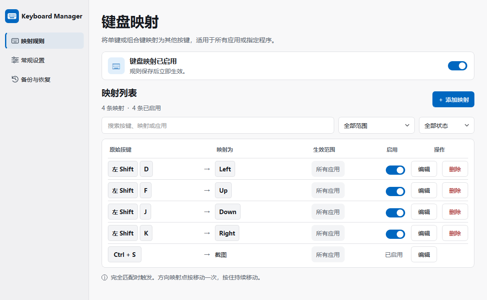
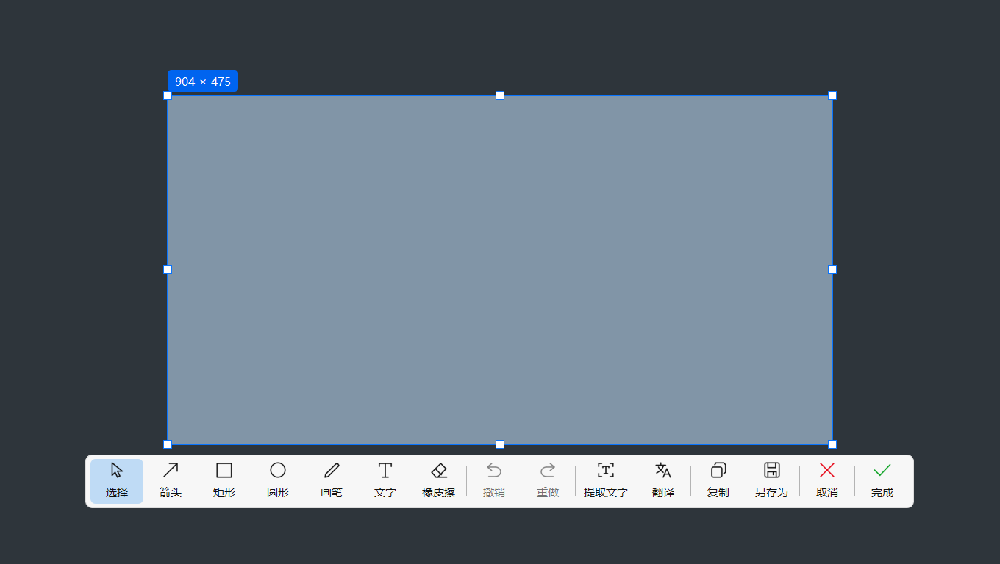

  <h1>Keyboard Manager</h1>
  
<strong>用顺手的按键移动光标，截图后直接标注、提取文字或翻译。</strong>

  
Windows 桌面工具 · 简体中文界面

  

    <strong><a href="https://github.com/Itkim666/Keyboard-Manager/releases/latest">下载 Windows 版</a></strong>
    &nbsp;·&nbsp;
    <a href="#快速上手">快速上手</a>
    &nbsp;·&nbsp;
    <a href="#截图标注与离线翻译">截图与翻译</a>
  

## 下载与安装

打开 **[最新发布页](https://github.com/Itkim666/Keyboard-Manager/releases/latest)**，展开页面底部的 **Assets（附件）**。选择适合自己的 Windows x64 下载项。

| 下载项 | 怎么开始 |
| --- | --- |
| **安装版 `.exe`** | 选择文件名带 `Setup` 的安装包，双击安装，再从开始菜单打开 Keyboard Manager。 |
| **便携版 `.zip`** | 选择文件名带 `Portable` 的压缩包。完整解压后，打开 `Keyboard Manager` 文件夹，双击 `Keyboard Manager.exe`。移动程序时请一起保留 `_internal` 文件夹。 |

两种下载项都附有中文 `使用说明.txt`。便携版和安装版在同一 Windows 用户下共享配置。需要换电脑时，可先在「备份与恢复」中导出配置，再在新电脑导入。

## 快速上手

### 让方向键回到手边

在写代码或编辑文档时，按住**左 Shift**，用 `D`、`F`、`J`、`K` 移动光标。点按移动一次，长按持续移动。

| 按键 | 左移 | 上移 | 下移 | 右移 |
| --- | --- | --- | --- | --- |
| 左 Shift + | <kbd>D</kbd> | <kbd>F</kbd> | <kbd>J</kbd> | <kbd>K</kbd> |

想换成自己的组合键，在「映射规则」里点击「添加映射」，录制原始按键和目标按键，再选「所有应用」或指定程序。规则保存后立即生效，可以单独停用，也可以从托盘暂停全部映射。

### 截图标注与离线翻译

按 <kbd>Ctrl</kbd> + <kbd>S</kbd> 打开截图，拖出选区后还能调整大小和位置。用箭头标出重点，用矩形、圆形、画笔或文字补充说明。编辑后可复制图片或另存为文件。

- **想复制图片里的字**，点「提取文字」，从结果窗口复制所需内容。
- **想读懂外语截图**，点「翻译」，在截图中查看原位替换后的简体中文，也可以单独复制文字译文。识别和翻译在本机运行。
- **想把截图留作资料**，点「另存为」保存到指定目录。选区边框和工具栏不会写入导出的图片。

## 常见问题

**`Ctrl+S` 和编辑器的保存键冲突怎么办？** 打开 Keyboard Manager 的「常规设置 → 截图快捷键」，录制新的组合键，也可以清除绑定。进入截图编辑器后，`Ctrl+S` 用于「另存为」。

**怎么临时恢复键盘原来的行为？** 在系统托盘右键点击 Keyboard Manager，选择「暂停映射」。需要继续时，在同一菜单选择「恢复映射」。

**已有规则怎么迁移？** 在「备份与恢复」导出配置文件。换电脑后导入它，并检查指定应用的路径是否和新电脑一致。

<strong>从源码构建与第三方组件</strong>

在 Windows x64 上准备 Python、Git、MinGW-w64 和 NSIS。在虚拟环境中安装 [构建依赖](packaging/requirements-build.txt)。从 [keymapper 上游](https://github.com/houmain/keymapper) 检出 [`tools/build-engine.ps1`](tools/build-engine.ps1) 指定的标签到 `keymapper-upstream/`，或使用最新发布附件中的对应源码。

在项目根目录构建映射引擎，再运行 [`tools/fetch-capture-models.py`](tools/fetch-capture-models.py) 和 [`tools/fetch-multilingual-models.py`](tools/fetch-multilingual-models.py) 获取模型。最后运行 [`packaging/build.ps1`](packaging/build.ps1)。可用 `-Python` 和 `-Nsis` 指定本机工具路径。

发行包附带第三方许可证和模型来源。NLLB 模型适用 CC BY-NC 非商业使用条款。

