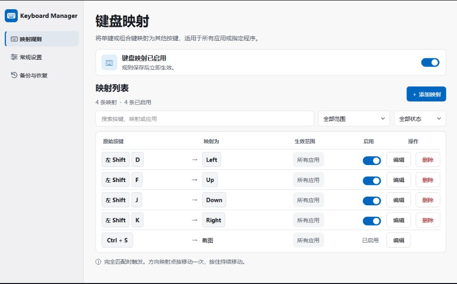

# Keyboard Manager

把常用按键映射到更顺手的位置，也可以在截图后直接标注、识别文字和翻译。

Windows x64 桌面工具 · 简体中文界面

[下载 Windows 版](https://github.com/Itkim666/Keyboard-Manager/releases/latest) · [项目介绍](#项目介绍) · [快速开始](#快速开始) · [使用指南](#使用指南) · [反馈与路线图](#开发状态与反馈)



## 项目介绍

Keyboard Manager 是一款 Windows 桌面工具，主要做两件事：把单键或组合键映射成其他按键；截取屏幕内容后，在同一个工具里完成标注、文字识别和翻译。

写文档、聊天或编程时，光标经常要左右移动；手离开打字区去找方向键，会打断输入。遇到截图，还常常要另外打开画图、OCR 或翻译软件。Keyboard Manager 把这些常用操作放在一个轻量的桌面程序里：你可以把方向键放到熟悉的位置，也可以按自己的习惯定义按键，并按需要限制它在哪些程序中生效。

软件适合经常编辑文字、写代码、使用输入法候选栏，或需要整理截图和外文资料的 Windows 用户。按键映射和截图处理是分开的功能，可以只使用其中一部分。

## 核心功能

### 自定义键盘映射

将一个按键或组合键映射为另一个按键或组合键。创建规则时，可以用键盘录制，也可以从按键列表选择；支持的按键包括字母、数字、修饰键、方向键、功能键和数字键盘等。

每条规则都可以选择「所有应用」或指定程序。指定程序时，可以从正在运行的应用中选取，也可以浏览到对应的 `.exe` 文件。规则保存后立即生效；列表里可以搜索、筛选、编辑、删除或单独停用规则。

默认方向键映射如下。点按移动一次，按住时持续移动：

| 按住 | 按键 | 结果 |
| --- | --- | --- |
| 左 Shift | `D` | 左方向键 |
| 左 Shift | `F` | 上方向键 |
| 左 Shift | `J` | 下方向键 |
| 左 Shift | `K` | 右方向键 |

如果输入法支持用方向键切换候选词，这组映射也能用来移动候选选择。要输入被映射的字母大写形式，可以使用右 Shift，或暂时暂停映射。

### 截图、标注与复制

默认按 `Ctrl + S` 开始截图；快捷键可以在「常规设置」中修改或清除。拖动鼠标框选屏幕区域后，可以拖动选区或使用八个控制点调整大小和位置。

截图工具提供箭头、矩形、圆形、画笔和文字标注，也可以用橡皮擦修改标注。右键标注工具可调整样式；操作过程中可以撤销或重做。完成后可将图片复制到剪贴板，或另存为文件。导出的图片不包含选区边框和工具栏。

截图编辑时可使用以下快捷键：

| 快捷键 | 操作 |
| --- | --- |
| `Ctrl + Z` | 撤销 |
| `Ctrl + Y` | 重做 |
| `Ctrl + C` | 复制截图 |
| `Ctrl + S` | 另存为 |
| `Esc` | 取消当前操作 |

### 截图文字识别与翻译

选好截图区域后，点「提取文字」即可在结果窗口查看并复制识别到的文字。文字识别在本机运行，不需要把截图上传到在线 OCR 服务。

点「翻译」后，软件会识别选区中的文字和语言，将外文翻译为简体中文，并尽量在原来的文字位置替换内容；译文也会显示在结果中，方便复制。识别和翻译模型随安装版、便携版提供，安装后可在本机完成处理。截图模糊、字号过小、文字遮挡或排版复杂时，识别和翻译结果可能不准确。

识别模型覆盖中文、英文，以及阿拉伯文、西里尔字母、天城文、希腊文、韩文、泰文等文字。翻译范围由随包模型支持的语言决定，截图翻译结果为简体中文。

### 设置、托盘与备份

「常规设置」可以选择跟随系统、浅色或深色主题，配置开机启动、关闭窗口后收起到托盘，以及暂停映射的快捷键。你也可以从系统托盘菜单暂停或恢复全部映射；从托盘退出后，映射引擎会停止。

「备份与恢复」可导出和导入映射规则。导入时可以合并规则或替换现有规则，也可以选择同时导入软件设置。应用程序路径和开机启动状态与新电脑环境有关：迁移后请检查指定程序路径，并在「常规设置」中单独确认开机启动选项。

## 适用场景

- **编辑文字或代码：** 用左 Shift 加 `D / F / J / K` 移动光标，修改前面的错字时不必把手移到键盘边缘。
- **使用中文输入法：** 对支持方向键切换候选词的输入法，用这组按键移动候选选择，再按原来的确认键上屏。
- **为常用操作自定义按键：** 把自己顺手的按键设为方向键或其他受支持按键；也可以让规则只在指定程序中生效。
- **整理截图或反馈问题：** 框出重点、加箭头或文字说明，再复制图片到聊天、文档或 GitHub Issue。
- **读取截图中的内容：** 识别图片里的文字，或把外文界面和资料翻译成简体中文，减少在多个工具之间来回复制。

## 快速开始

### 系统要求

- Windows x64。
- 建议以普通 Windows 用户权限运行。此版本不以管理员权限运行，因此在管理员权限启动的程序中，按键映射可能无法生效。
- 日常使用不需要另装 Python、Git 或模型；识别和翻译模型已随发布包提供。因为包含离线模型，安装包和便携包体积较大。

### 下载与安装

打开 [最新发布页](https://github.com/Itkim666/Keyboard-Manager/releases/latest)，在页面底部的 **Assets（附件）** 中选择一个 Windows x64 版本：

| 下载项 | 安装方式 |
| --- | --- |
| **安装版 `.exe`**（文件名含 `Setup`） | 双击安装包，按提示选择安装目录；安装完成后从开始菜单打开 Keyboard Manager。 |
| **便携版 `.zip`**（文件名含 `Portable`） | 将压缩包完整解压到目标目录，进入 `Keyboard Manager` 文件夹，双击 `Keyboard Manager.exe`。请保留旁边的 `_internal` 文件夹。 |

安装版和便携版在同一个 Windows 用户下共享配置，配置保存在 `%LOCALAPPDATA%\Keyboard Manager`。更换电脑前，可先导出配置，到新电脑再导入。

## 使用指南

### 创建一条映射规则

1. 打开 Keyboard Manager，在「映射规则」页点击「添加映射」。
2. 在「原始按键」一栏点击「录制」，按下要触发的单键或组合键；也可以点「列表」选择按键。
3. 在「映射为」一栏录制或选择要输出的按键。
4. 选择「所有应用」或「指定程序」。指定程序时，选择正在运行的应用，或浏览到它的 `.exe` 文件。
5. 保存后规则立即生效。之后可以在规则列表中搜索、筛选、编辑、单独启用或停用。

### 截图、提取文字或翻译

1. 按默认快捷键 `Ctrl + S`，或使用「常规设置」中设置的截图快捷键。
2. 拖动鼠标框选区域；需要微调时，拖动选区或控制点。
3. 选择标注工具补充箭头、形状、画笔或文字。需要时可以右键工具调整样式，也可以撤销和重做。
4. 点「提取文字」查看可复制的识别结果；点「翻译」将识别到的外文翻译为简体中文。
5. 点「复制」把截图放入剪贴板，或点「另存为」保存图片。截图编辑中的 `Ctrl + S` 是另存为。

### 备份和迁移设置

1. 打开「备份与恢复」，选择导出并保存 JSON 配置文件。
2. 在新电脑安装或解压 Keyboard Manager 后，进入同一页面选择导入。
3. 选择合并规则或替换全部规则；如需一起恢复主题等软件选项，勾选「同时导入软件设置」。
4. 检查指定程序映射的 `.exe` 路径，并在「常规设置」中单独确认开机启动选项。

## 技术架构

| 模块 | 实现 |
| --- | --- |
| 桌面界面 | Python、PyQt5 / Qt Widgets，负责映射规则、设置、备份与截图界面。 |
| 按键映射 | Windows 版本的 keymapper 5.8.1 引擎；项目包含组合键释放行为的修改，并由 C++ / MinGW-w64 构建。 |
| Windows 集成 | Windows API 用于注册系统级快捷键、读取应用程序路径和处理键盘钩子；Qt 管理托盘界面。 |
| 截图与标注 | 基于 Qt 绘制选区、标注、撤销/重做及图片复制和保存。 |
| 文字识别 | RapidOCR 与 ONNX Runtime，在本机处理截图中的文字。 |
| 截图翻译 | CTranslate2、SentencePiece 和随包的本地模型；多语言识别结果翻译为简体中文。 |
| 配置保存 | JSON 文件保存在当前 Windows 用户的 `%LOCALAPPDATA%` 目录。 |
| Windows 打包 | PyInstaller 生成应用目录，NSIS 生成安装版；同一构建脚本也生成便携版和源码包。 |

主要代码入口：[`app.py`](src/keyboard_shortcuts/app.py)、[映射规则](src/keyboard_shortcuts/rules.py)、[引擎控制](src/keyboard_shortcuts/engine.py)、[配置与备份](src/keyboard_shortcuts/store.py)、[截图界面](src/keyboard_shortcuts/capture.py)、[本地文字识别](src/keyboard_shortcuts/capture_text.py)、[截图翻译](src/keyboard_shortcuts/capture_translation.py)。

### 从源码构建

源码构建需要 Windows x64、Python、Git、MinGW-w64（`g++` 可从命令行调用）和 NSIS。在虚拟环境中安装项目构建依赖：

```powershell
python -m venv .buildenv
.\.buildenv\Scripts\python.exe -m pip install -r .\packaging\requirements-build.txt
```

将 keymapper 5.8.1 源码检出到项目根目录下的 `keymapper-upstream/`，构建映射引擎并下载本地模型：

```powershell
git clone --branch 5.8.1 --depth 1 https://github.com/houmain/keymapper.git keymapper-upstream
.\tools\build-engine.ps1
.\.buildenv\Scripts\python.exe .\tools\fetch-capture-models.py
.\.buildenv\Scripts\python.exe .\tools\fetch-multilingual-models.py
```

最后运行 [`packaging/build.ps1`](packaging/build.ps1) 生成安装版和便携版。脚本默认从项目指定的工具路径读取 Python、NSIS 和模型；如本机路径不同，可用 `-Python` 和 `-Nsis` 参数指定。完整的 Python 依赖见 [`packaging/requirements-build.txt`](packaging/requirements-build.txt)。

构建过程中下载的模型和安装包中的第三方组件各有自己的授权条件，分发前请一并检查许可证和模型来源说明。

## 常见问题

**`Ctrl + S` 和其他软件的保存快捷键冲突怎么办？** 在「常规设置 → 截图快捷键」中录制新的组合键，或清除绑定。进入截图编辑器后，`Ctrl + S` 用于另存为。

**怎么临时恢复原来的按键行为？** 右键点击系统托盘中的 Keyboard Manager，选择「暂停映射」；需要继续时选择「恢复映射」。也可以在常规设置里录制暂停快捷键。

**怎么输入被映射的字母大写形式？** 默认映射使用左 Shift。输入对应大写字母时可改用右 Shift，或先暂停映射。

**映射在某些程序里没有生效怎么办？** 本版本以普通权限运行。管理员权限启动的应用可能不会响应；另外，如果 PowerToys 等工具中启用了相同映射，请停用其中一处规则，避免冲突。

**换电脑后指定程序规则失效怎么办？** 规则按程序 `.exe` 路径限定范围。导入配置后，请重新选择新电脑上的程序文件。

**截图识别和翻译需要联网吗？** 识别和翻译模型随 Windows 发布包一起提供，处理过程在本机运行。下载发布包和源码构建所需模型时需要网络。

## 开发状态与反馈

项目目前提供 Windows x64 安装版和便携版，已实现键盘映射、截图标注、离线文字识别、截图翻译、托盘控制以及配置备份与恢复。发行版和下载文件以 [GitHub Releases](https://github.com/Itkim666/Keyboard-Manager/releases) 为准。

仓库目前没有单独发布的开发路线图；哪些功能正在开发或计划实现，以项目维护者在 [GitHub Issues](https://github.com/Itkim666/Keyboard-Manager/issues) 中确认的信息为准。使用中遇到问题、发现说明不清楚，或有功能建议，都可以在那里提交 Issue。

## 项目与授权信息

- 项目仓库：[github.com/Itkim666/Keyboard-Manager](https://github.com/Itkim666/Keyboard-Manager)
- Windows 下载：[最新发布页](https://github.com/Itkim666/Keyboard-Manager/releases/latest)
- 问题反馈与建议：[GitHub Issues](https://github.com/Itkim666/Keyboard-Manager/issues)
- 按键引擎：[keymapper 5.8.1 上游源码](https://github.com/houmain/keymapper/tree/5.8.1)。项目对其组合键释放行为做了修改；仓库中的授权文件为 [`keymapper-LICENSE.txt`](keymapper-LICENSE.txt)。
- 模型授权：NLLB 模型采用 **CC BY-NC 4.0**，限非商业使用。发行包中附有第三方组件许可证及模型来源文件，请在再分发前检查相应条款。

安装包与便携包都附带中文 `使用说明.txt`，源码构建脚本会生成 `Keyboard-Manager-<版本>-Source.zip`。
